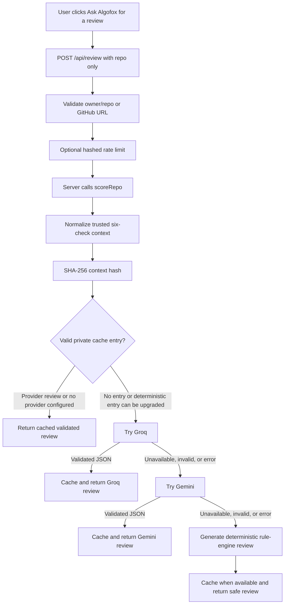

# Algofox and the WelcomeScore Dev Roast & Motivation Engine

**Implementation blueprint and operating guide**  
**Product:** WelcomeScore.js.org  
**Status:** Implemented and deployed, with deterministic reviews fully operational and optional provider enhancement configured for further troubleshooting.

> **Simple explanation:** Algofox is WelcomeScore’s friendly developer companion. WelcomeScore first measures whether a public GitHub repository is welcoming to a first-time contributor. Algofox then explains the result in human language: what is working, what needs attention, and the next practical step. It can be encouraging, lightly tough when the technical evidence supports it, and celebratory for strong contributor paths. It is never meant to judge or insult a person.

## 1. What has been built

WelcomeScore now has two connected layers. The first is the **auditing layer**, which checks a public GitHub repository against a fixed contributor-readiness rubric. The second is the **Algofox guidance layer**, which turns the already-measured audit result into concise, evidence-based encouragement and, when the user chooses, a technical roast.

Algofox is a supplied cyber-fox mascot—half organic fox and half robot. It is based on the provided Algofox asset by `@dude`, which provides nine usable animation states in an 8×9 sprite atlas. WelcomeScore uses that supplied visual asset as its companion, but its product behavior, scoring logic, safety rules, interface, and provider architecture are specific to WelcomeScore. The asset reference identifies the 1536×1872 atlas, 192×208 frames, and nine states. [1]

| Layer | Responsibility | User benefit |
|---|---|---|
| **WelcomeScore audit** | Measures six visible contributor signals in a public GitHub repository. | A simple score, grade, evidence pills, contributor issue links, Hall eligibility, and badge data. |
| **Algofox companion** | Provides visual states, temporary guidance bubbles, drag placement, and small interaction feedback. | A helpful, unobtrusive character rather than a passive decoration. |
| **Dev Roast & Motivation Engine** | Converts trusted audit facts into constructive guidance and an opt-in technical roast. | Clear next steps without unsupported claims or personal attacks. |
| **Optional model providers** | Improve wording only after server-side validation. | More varied, natural phrasing when a provider is healthy. |
| **Private cache and rate limit** | Reduces repeat provider work and protects the endpoint. | Faster repeat responses and controlled operational cost. |

## 2. The mental model: think of Algofox as a guide, not an autonomous agent

Algofox is intentionally **not** an autonomous bot that scans repositories, posts into the Lounge, or adds entries to the Hall of Fame. It only reacts to actions already chosen by the user. This can be understood as a three-step model:

1. **Observe trusted evidence.** WelcomeScore audits only its fixed scoring signals.
2. **Explain the evidence.** Algofox selects a relevant technical suggestion and concise tone.
3. **Let the user decide.** The user may ask for a review, add an eligible project to the Hall, share a badge, or share to the Lounge—but none of these occur automatically.

> Algofox has a voice, but it has no independent permission to publish, persist user content, or claim facts beyond the audit.

## 3. The mascot model

### 3.1 Global placement and availability

Algofox is mounted once in the global application shell. This means it is available on the audit page, Hall of Fame, Dev Lounge, badge sharing flow, and supporting pages without each page needing to create a second mascot. The app wraps the site in `AlgofoxPetProvider` and renders one `AlgofoxWidget` beside the shared site footer.

The companion starts in a bottom-right dock and is intentionally small. It follows the project’s dark visual language: base `#12141C`, surface `#1B1E29`, muted text, orange accent `#E8A23D`, rectangular `rounded-md` surfaces, and restrained motion. It does not introduce loud particles, forced confetti, sound effects, screen shake, or red failure styling.

### 3.2 Canonical identity

**Algofox is the only companion identity in the active product.** Earlier development labels, **Gob** and **Sukuna**, were legacy internal reaction names; they are not people, accounts, or mascots in the current product. New Lounge reactions now write `algofox` only. For existing short-lived Lounge rows that contain historical metadata, the display layer renders the name as Algofox without editing or deleting user-authored message content.

| Name | Meaning now | Treatment |
|---|---|---|
| **Algofox** | The official WelcomeScore developer companion. | Used across audit feedback, review cards, badge feedback, and Lounge co-hosting. |
| **Gob** | Earlier internal/placeholder companion label. | Removed from active source behavior. |
| **Sukuna** | Earlier internal/placeholder companion label. | Removed from active source behavior. |

### 3.3 Animation states

The sprite renderer uses the actual supplied state rows and frame counts rather than inventing unsupported animation names. The underlying Codex-pet convention uses a manifest plus sprite sheet and defines these nine standard companion states. [1] [2]

| State | Frames | WelcomeScore meaning |
|---|---:|---|
| `idle` | 6 | Calm resting state after a message disappears. |
| `run-right` | 8 | Algofox is being dragged or traveling toward the right. |
| `run-left` | 8 | Algofox is being dragged or traveling toward the left. |
| `waving` | 4 | Friendly acknowledgement after a direct tap/click. |
| `jumping` | 5 | Celebration after a strong audit or positive review result. |
| `failed` | 8 | A gentle “needs attention” state after an unsuccessful audit or low score. |
| `waiting` | 6 | Quiet idle indication after one minute without interaction. |
| `running` | 6 | Audit is in progress. |
| `review` | 6 | Algofox is inspecting or reviewing contributor evidence. |

The canvas renderer respects the operating-system **reduced-motion** preference. When reduced motion is requested, the appropriate state frame is shown without cycling the animation.

### 3.4 Temporary speech behavior

Algofox’s written messages are deliberately temporary. The default bubble duration is **4.5 seconds**, inside the requested 3–6 second range. A message disappears on its own and Algofox returns to `idle`; the fox remains visible and available.

| Trigger | State | Typical message lifetime | Example purpose |
|---|---|---:|---|
| Initial page presence | `idle` | 4.5 seconds | Briefly explains that Algofox can inspect a contributor path. |
| Repository field focus | `review` | 4 seconds | Explains that the audit checks a GitHub repository. |
| Audit in progress | `running` | Until replaced by audit outcome | Signals that the app is checking the six contributor facts. |
| Score below 75 | `failed` | 5 seconds | Encourages improving one contributor signal at a time. |
| Score 75–84 | `review` | 5 seconds | Notes a solid foundation and invites a final review. |
| Score 85+ | `jumping` | 5 seconds | Celebrates a strong contributor path. |
| One minute of inactivity | `waiting` | 4.5 seconds | Gives a quiet, non-blocking “I’ll be here” signal. |
| Manual fox tap | `waving` | 4 seconds | Offers a friendly prompt. |
| Successful review card result | `review`, `failed`, `jumping`, or `waving` | 6 seconds | Mirrors the validated review result. |

The close control can manually hide the entire companion. A visible **Show Algofox** button restores it. This is a user-controlled visibility choice, not an automatic setting that changes application data.

### 3.5 Drag and travel interaction

Algofox is draggable with mouse or touch. The design treats a short tap as a normal companion interaction and requires movement of at least **6 pixels** before interpreting input as a drag. This prevents accidental movement when a user just wants a prompt.

While traveling, Algofox changes to the supplied left/right running sprite according to horizontal direction. On drop, it displays a short happy message—“Nice route. Algofox is happy to explore your developer workspace.”—for **4.5 seconds**, then returns to calm idle behavior.

| Safeguard | How it works |
|---|---|
| **Pointer capture** | The fox keeps the active mouse/touch gesture even if the pointer moves quickly. |
| **Viewport bounds** | Its position is clamped with a 12-pixel margin so the companion and message remain on screen. |
| **Mobile safety** | `touch-action: none` applies only to the fox control during dragging, preventing accidental page drag conflicts. |
| **Resize handling** | A viewport resize re-clamps a dragged companion back within safe bounds. |
| **Reset** | A compact **Reset position** control appears after the fox is moved. Pressing Escape also resets its position when focused. |
| **No persistent tracking** | The dragged placement is in client state only; it is not written to Supabase, GitHub, Hall of Fame, or Dev Lounge. |

## 4. The source of truth: WelcomeScore’s contributor audit

Algofox does not inspect raw source code or invent its own repository quality score. It is limited to the `ScoreResult` produced by the existing server-side `scoreRepo` pipeline. That pipeline reads public GitHub metadata, root files, the README endpoint, and the issue search already needed by the scorer. GitHub calls are cached for five minutes.

### 4.1 Fixed scoring signals

| Check | Maximum points | What is actually measured |
|---|---:|---|
| `CONTRIBUTING.md` | 20 | Whether that file exists at repository root. |
| `CODE_OF_CONDUCT.md` | 15 | Whether that file exists at repository root. |
| README setup section | 15 | Whether the README contains a heading matching install, setup, getting started, or quick start. |
| `LICENSE` | 10 | Whether GitHub reports a license. |
| Good-first-issue labels | 25 | Open issue-search count for newcomer-oriented labels, scaled up to ten issues. |
| Recently active | 15 | Whether GitHub reports a push within the last three months. |

The total is from 0 to 100. Grades are `A` at 90+, `B` at 75–89, `C` at 60–74, `D` at 40–59, and `F` below 40.

The audit also returns repository name, default branch, stars, forks, primary language, README/license flags, eligibility, number of newcomer issues, and up to five issue title/link pairs. That richer data supports the audit UI, but the review engine receives only a deliberately reduced and normalized context.

### 4.2 Hall of Fame eligibility is separate

A repository becomes eligible for the Hall of Fame only when all of the following are true:

| Requirement | Rule |
|---|---|
| Score | At least 75. |
| Community signal | At least 5 stars **or** at least 2 forks. |
| README | A README exists. |
| License | A license exists. |

Even then, the user must choose **Add to Hall of Fame**. The review engine cannot add a project, refresh an entry, or overwrite community data. A separate Hall status check detects a previously listed repository and the UI shows the existing-entry state instead of producing duplicates.

## 5. The Dev Roast & Motivation Engine

### 5.1 User journey

The review card appears only **after** an audit result. It is placed after the score evidence and beginner-issue links, and before the independent Hall of Fame controls. It does not automatically fetch a review.

1. A user audits a repository.
2. WelcomeScore shows the score, grade, and six check pills.
3. The user explicitly clicks **Ask Algofox for a review**.
4. The server independently re-scores the repository and creates a trusted review context.
5. Algofox returns a concise response.
6. The card starts on **Guidance**. The user may intentionally switch to **Technical roast**.
7. The user may independently refresh the review, add to the Hall if eligible, open the badge modal, or open Dev Lounge sharing.

> The roast is opt-in; constructive guidance is the default visible experience.

### 5.2 Review response model

All accepted reviews use schema version 1. Whether text comes from deterministic logic, Groq, or Gemini, it must conform to the same response contract.

| Field | Meaning | Guardrail |
|---|---|---|
| `schemaVersion` | Response contract version. | Must equal `1`. |
| `mode` | `motivation`, `tough-love`, or `celebration`. | Only these three modes are allowed. |
| `spriteState` | Review reaction for the visible mascot. | Must be `review`, `failed`, `jumping`, or `waving`. |
| `headline` | Short summary line. | Required, trimmed, maximum 80 characters. |
| `roastText` | Concise technical roast. | Required, technical only, maximum 220 characters. |
| `motivationText` | Practical next step. | Required, maximum 180 characters. |
| `focusChecks` | The one or two relevant check labels. | Must come from actual failed/partial audit checks only. |
| `provider` | `rule-engine`, `groq`, or `gemini`. | Assigned server-side and validated. |

### 5.3 Trusted review context

Before any wording is generated, `createTrustedReviewContext` produces a normalized snapshot. It includes the normalized repository path, score, grade, primary language, README/license flags, good-first-issue count, six normalized checks, and up to two focus checks.

Focus checks are selected only from missed or partial checks and are sorted using a deliberate contributor-impact order:

1. `LICENSE`
2. `README setup section`
3. `CONTRIBUTING.md`
4. `CODE_OF_CONDUCT.md`
5. `Good-first-issue labels`
6. `Recently active`

This ordering prevents a flashy but less important message from displacing a core newcomer block. For example, a missing license or setup section receives attention before lower-priority polish.

### 5.4 Deterministic engine: the dependable baseline

The deterministic engine is the real foundation of the feature. It works even when no provider key is configured, providers are down, a model response is malformed, or the private cache is unavailable.

| Score band | Mode | Sprite | Review behavior |
|---:|---|---|---|
| 85–100 | Celebration | `jumping` | Recognizes a contributor-ready path and recommends keeping newcomer documentation and issues maintained. |
| 75–84 | Motivation | `review` | Calls out a strong foundation with a small remaining contributor detail. |
| 50–74 | Motivation | `review` | Identifies the highest-priority missing contributor signal and gives one practical action. |
| 0–49 | Tough love | `failed` | Gives a factual technical roast targeting the clearest missing signal, then suggests a concrete recovery step. |

Examples are tied to a failed check. If `LICENSE` is missing, the engine explains that contribution use rights are unclear and recommends adding an appropriate license. If README setup is absent, it recommends prerequisites, installation, and one successful run. If newcomer labels are missing, it recommends one or two scoped good-first issues with enough context to begin.

No generic provider wording is allowed to bypass that evidence requirement.

## 6. Safety architecture

### 6.1 The review engine deliberately does not know everything

The input prompt and server validator explicitly forbid claims about facts WelcomeScore has not measured. The system must not infer or state any of the following:

- Test coverage, CI configuration, source-code quality, or security posture.
- Pull-request review speed, issue staleness, branch protection, direct-main commits, or maintainer intent.
- Whether a repository is “in the Hall of Fame.”
- Personal qualities of contributors, maintainers, organizations, or communities.

Raw README text, issue bodies, comments, repository source files, secrets, user messages, or arbitrary browser metrics are not sent to a model. The engine uses its small, normalized audit context only.

### 6.2 Tone controls

The provider prompt requires concise, constructive, technical wording. It explicitly prohibits personal attacks, targeting people or groups, threats, profanity, and unsupported Hall claims. The “roast” targets the **repository workflow**, not a human being.

The browser has no opportunity to submit its own fake score/check payload. `POST /api/review` accepts only `{ "repo": "owner/repo" }`; the server validates that repository shape, runs `scoreRepo` itself, then builds the context itself.

### 6.3 Validation after every model response

External AI output is untrusted. A model’s JSON must be parsed and pass the same local `validateAlgofoxReview` checks as a deterministic response. In particular, it is rejected if it has an unsupported mode, unsupported sprite state, unapproved provider label, empty/overlong text, more than two focus checks, or a focus check that is not in the trusted audit context.

> A provider may improve phrasing; it cannot create new evidence.

## 7. Optional provider model architecture

Provider use is optional and server-only. The response route tries providers in a fixed order, then falls back safely.

### 7.1 Groq

Groq is the primary optional provider. The service calls the OpenAI-compatible chat-completions endpoint with a server-only `GROQ_API_KEY`, a configurable `GROQ_REVIEW_MODEL`, explicit JSON-only instructions, and a **6-second** deadline. It uses JSON Object Mode, then applies local schema and evidence validation. This avoids relying solely on provider-side schema enforcement while retaining a safe output boundary. Groq documents JSON Object Mode as valid JSON guidance that should be paired with explicit instructions and application-side validation. [3]

### 7.2 Gemini

Gemini is the fallback optional provider. It uses `GEMINI_API_KEY`, `GEMINI_REVIEW_MODEL`, Gemini `generateContent`, `responseMimeType: application/json`, and a response JSON schema. It tries the configured model name first, then compatible fallback candidates. Its deadline is **2.5 seconds per candidate**. Gemini’s structured-output APIs are schema-guided, but WelcomeScore still performs server-side validation because provider schema adherence is not a substitute for the product’s factual safety rules. [4]

### 7.3 Current operational truth

The provider integration is designed to be optional. The deterministic review engine is working in production. During the latest authorized checks, the live result identified itself as `provider: rule-engine`, meaning the system correctly fell back when external-provider responses were not accepted.

Earlier safe Vercel diagnostics recorded a Groq HTTP `400` and Gemini HTTP `404`. Compatibility updates were pushed to use Groq JSON Object Mode, wider time allowance, and a Gemini candidate fallback sequence. The current configured-model values recommended for Vercel were:

| Environment variable | Recommended value |
|---|---|
| `GROQ_REVIEW_MODEL` | `openai/gpt-oss-120b` |
| `GEMINI_REVIEW_MODEL` | `gemini-3.7-flash` |

The provider issue does **not** break the feature: an evidence-based deterministic review continues to return. A future diagnostic pass should use Vercel Logs after a new review request and confirm provider-status lines; no key, raw repository content, or secret should be logged.

## 8. Private cache, database, and rate limits

The review engine uses a dedicated Supabase migration. It is additive and does not change `repo_evaluations`, Hall of Fame rows, Lounge messages, reactions, or reply data.

### 8.1 Cache design

The cache key is a SHA-256 hash of the complete normalized review context, including schema version. This naturally invalidates a prior review when the score or underlying check facts change.

| Cache property | Implementation |
|---|---|
| Table | `public.review_cache` |
| Unique key | `context_hash` |
| Stored content | Normalized repository path, score, review version, provider marker, validated JSON payload, timestamps, expiry. |
| Deterministic TTL | 24 hours. |
| Valid Groq/Gemini TTL | 7 days. |
| Cache promotion | A valid deterministic cache response can be upgraded when a provider is newly configured and returns an accepted response. |
| Failure behavior | Missing Supabase configuration/table, cache error, or write error does not prevent a deterministic review. |

### 8.2 Privacy and permissions

Row-level security is enabled on both `review_cache` and `review_rate_limits`. Browser roles (`anon` and `authenticated`) have all access revoked. The server role has only the required cache permissions and only the server role may execute the rate-limit function.

The browser never calls the cache table directly and never receives a provider key or Supabase service-role key.

### 8.3 Rate limit

When `ALGOFOX_REVIEW_RATE_LIMIT_SALT` is configured, the review route combines that server-only salt with the forwarded client IP and stores only a SHA-256 bucket hash. The actual IP is not stored in the rate-limit table.

The current policy allows **12 review requests per hour per salted bucket**. If it is exceeded, the route returns a `429` response, and the UI presents a muted retry message. If the rate-limit backend is temporarily unavailable, the deterministic review remains available rather than failing closed on a non-critical dependency.

### 8.4 Cleanup

The Supabase migration creates an idempotent `pg_cron` job. It runs at minute 17 of each hour, deletes expired review cache rows, and deletes rate-limit buckets not updated for two days.

## 9. What Algofox does on each area of the product

| Area | Algofox behavior | What it does **not** do |
|---|---|---|
| **Audit home / check page** | Indicates input, scanning, score outcome, and opt-in review result. | It does not start an audit without a user action except the existing explicit repository link route. |
| **Algofox review card** | Appears after an audit. The user clicks to request a review, sees guidance first, and can select Technical roast. | It does not modify score data, Hall data, or Lounge data. |
| **Hall of Fame** | Provides optional visual feedback elsewhere in the shared UI. | It does not auto-add, refresh, duplicate, or remove Hall entries. |
| **Badge modal** | Gives small review/celebration feedback when selecting a badge or copying an embed. | It does not post or share automatically. |
| **Dev Lounge** | Appears as a visual co-host; score-card reactions use Algofox display identity only. | It does not write review content to chat, create a message, react autonomously, or alter user messages. |
| **Global companion** | Provides a short greeting, inactivity behavior, manual prompt, drag travel feedback, hide/show, and reset. | It does not persist placement or track a user’s screen activity beyond local interaction events. |

## 10. Badge and brand integration

WelcomeScore has a separate live SVG badge engine with four styles: Minimal, Rank Shield, Metrics, and Dark Glow. Those badges remain driven by the same server-side score data, not by LLM output.

The **Dark Glow** style was corrected so the rank crown has a dedicated visual column and cannot overlap the `100` score. The crown is placed to the left of a separately anchored three-digit score, with explicit spacing. All four live style routes were validated to return `200 image/svg+xml` after the correction.

The badge modal supports Markdown/HTML embed copy and optional X/LinkedIn sharing actions that are explicitly initiated by the user. No sharing action occurs because Algofox gave a review.

## 11. Operational configuration checklist

The optional provider keys belong in **Vercel Environment Variables**, never in `NEXT_PUBLIC_*` variables and never in client code. Use Production and Preview; Development is optional.

| Variable | Required? | Scope | Purpose |
|---|---|---|---|
| `GITHUB_TOKEN` | Optional but recommended | Server only | Improves GitHub audit-rate capacity. |
| `SUPABASE_URL` | Required for cache/Hall server integration | Server only | Supabase project endpoint. |
| `SUPABASE_SERVICE_ROLE_KEY` | Required for private review cache | Server only | Server-only cache and rate-limit permissions. |
| `GROQ_API_KEY` | Optional | Server only | Enables Groq wording enhancement. |
| `GROQ_REVIEW_MODEL` | Optional | Server only | Selects the Groq review model. |
| `GEMINI_API_KEY` | Optional | Server only | Enables Gemini fallback wording enhancement. |
| `GEMINI_REVIEW_MODEL` | Optional | Server only | Selects the Gemini fallback model. |
| `ALGOFOX_REVIEW_RATE_LIMIT_SALT` | Recommended | Server only | Creates non-reversible hashed request-limit buckets. |
| `NEXT_PUBLIC_SUPABASE_URL` | Required for Lounge browser client | Public by design | Browser-accessible Dev Lounge endpoint. |
| `NEXT_PUBLIC_SUPABASE_PUBLISHABLE_KEY` | Required for Lounge browser client | Public by design | Browser-accessible Supabase publishable key. |

After changing a Vercel environment variable, redeploy the latest production build. Saving a value alone does not rewrite an already-running deployment.

## 12. Implemented source map

| File / component | Role |
|---|---|
| `app/layout.tsx` | Mounts the global Algofox provider and widget once for the whole site. |
| `app/components/pet/AlgofoxPetProvider.tsx` | Holds global state, temporary quotes, animation reset timer, inactivity behavior, and visibility. |
| `app/components/pet/AlgofoxSprite.tsx` | Renders the real sprite atlas on canvas and honors reduced motion. |
| `app/components/pet/AlgofoxWidget.tsx` | Global dock, temporary bubble, hide/show, draggable movement, travel feedback, reset control, and viewport constraints. |
| `lib/scoreRepo.ts` | Authoritative GitHub audit and fixed scoring rules. |
| `app/api/score/route.ts` | Thin public audit endpoint built on the shared scorer. |
| `lib/review/types.ts` | Review response contract, trusted context normalization, focus selection, and validation. |
| `lib/review/context.ts` | SHA-256 context hash and tightly constrained provider prompt. |
| `lib/review/deterministic.ts` | Always-available evidence-based guidance and roast logic. |
| `lib/review/providers.ts` | Groq-first, Gemini-second optional provider cascade with timeouts and local validation. |
| `lib/review/cache.ts` | Server-only Supabase cache and salted request-rate limit helpers. |
| `app/api/review/route.ts` | Secure orchestration endpoint accepting only `{ repo }`. |
| `app/components/AlgofoxReviewCard.tsx` | Opt-in audit-result review UI, Guidance/Roast tabs, muted errors, and mascot reaction. |
| `supabase/migrations/20260826_algofox_review_engine.sql` | Private cache, rate-limit accounting, RLS, grants, function, and cleanup job. |
| `hooks/useDevLounge.ts` | Dev Lounge data logic; new score-card companion metadata is Algofox only. |
| `app/lounge/page.tsx` | Lounge UI; display-normalizes legacy companion metadata as Algofox without changing user messages. |
| `lib/badgeEngine.ts` | Four dynamic SVG badge styles, including corrected Dark Glow crown/score spacing. |

## 13. Key deployment milestones

| Commit | Delivered change |
|---|---|
| `abc6be3` | Initial secure Algofox review engine, card, migration, documentation, and fallback foundation. |
| `a2fa249` | Allows provider output to upgrade an earlier deterministic cache result. |
| `22f059f` | Hardened provider fallback compatibility and diagnostics. |
| `fb5253c` | Switched Groq to resilient JSON Object Mode with local validation. |
| `ffa41d0` | Extended the separate user-triggered provider response window. |
| `8211a10` | Made Algofox speech bubbles temporary by default. |
| `d3f6c35` | Added bounded drag-and-drop travel behavior and reset placement. |
| `9847882` | Unified Lounge companion identity under Algofox. |
| `d376b6b` | Separated the Dark Glow rank crown from the score number. |

## 14. Acceptance criteria already satisfied

| Requirement | Current status |
|---|---|
| One official mascot identity | **Satisfied:** Algofox only in active product behavior. |
| Real supplied animation states | **Satisfied:** nine verified state rows and frame counts. |
| Temporary, non-sticky speech | **Satisfied:** default 4.5 seconds, then idle. |
| Draggable companion | **Satisfied:** mouse/touch pointer drag, bounds, reset, travel state, short happiness feedback. |
| Opt-in review request | **Satisfied:** no automatic review fetch. |
| Constructive default and opt-in roast | **Satisfied:** Guidance is the default tab; Technical roast is a deliberate tab selection. |
| Factual technical content | **Satisfied:** review receives only normalized existing audit evidence. |
| No browser-supplied score facts | **Satisfied:** review endpoint accepts only repository input and rescoring happens server-side. |
| Provider output validation | **Satisfied:** all provider JSON is locally parsed, bounded, and evidence-validated. |
| Deterministic fallback | **Satisfied:** works with no keys or provider failure. |
| Private cache / browser blocking | **Satisfied:** separate RLS-enabled table and server-role access only. |
| Explicit Hall action | **Satisfied:** no review path reaches Hall add/refresh behavior. |
| Lounge independence | **Satisfied:** review path contains no Lounge write/reaction action. |
| Badge integrity | **Satisfied:** badge engine is separate from review text; Dark Glow overlap fixed. |

## 15. Recommended next work

The core system is stable because it does not depend on an LLM. The most appropriate next steps are operational rather than a redesign:

1. **Finish provider diagnosis using safe Vercel logs.** Confirm the exact current HTTP status and model identifier after a user-triggered review. Resolve the Groq/Gemini configuration only if the team wants model-enhanced wording; deterministic mode remains a valid production mode.
2. **Add explicit server monitoring.** Track provider success/fallback counts as aggregate operational metrics without retaining raw review prompts or user IPs.
3. **Add deterministic review tests to continuous integration.** The project already has a lightweight verification script; a formal test runner could make regression coverage automatic on every pull request.
4. **Consider optional local placement persistence only with consent.** If users ask for it, a browser-only preference could restore their chosen fox location without adding a database profile or tracking.
5. **Keep the audit rubric versioned.** If additional evidence is ever added—such as CI status—it should be explicitly measured, reviewed for reliability, added to a new schema version, and never inferred by a provider.

## References

[1]: https://codingpets.com/pets/algofox-dude "Coding Pets — Algofox Codex Pet by @dude"
[2]: https://github.com/crafter-station/petdex "Petdex — public animated companion format and state conventions"
[3]: https://console.groq.com/docs/structured-outputs "Groq Structured Outputs and JSON Object Mode"
[4]: https://ai.google.dev/gemini-api/docs/structured-output "Gemini API Structured Output documentation"

---

**In one sentence:** WelcomeScore measures a repository using a fixed, transparent contributor rubric; Algofox makes that result feel alive and understandable through a temporary, draggable, evidence-bound companion experience that stays respectful, optional, private, and under the user’s control.
