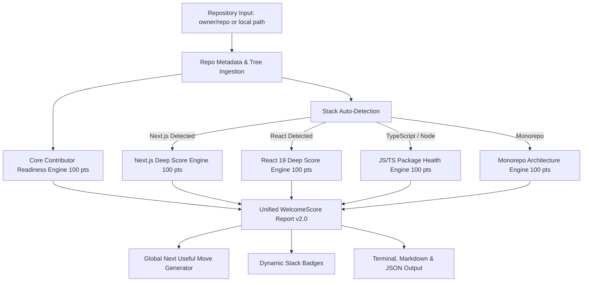

# WelcomeScore Worldwide Growth & Deep Stack Scoring Roadmap

> **Strategic Vision:** Evolve WelcomeScore from a repository contributor-readiness auditor into the universal, zero-friction standard for open-source repository health, modern framework best practices (Next.js, React, TypeScript), and developer onboarding.

---

## 1. Executive Summary & Market Opportunity

WelcomeScore has established a rock-solid foundation:
- **Zero-Friction Audits:** Instant, deterministic evaluation of any public GitHub repository without OAuth or rate-limit friction.
- **Actionable Next Useful Move:** Rather than overwhelming maintainers with vague metrics, WelcomeScore delivers the single highest-impact next step with ready-to-merge issue drafts, patch plans, and acceptance criteria.
- **Unified Multi-Surface Experience:** Live web app, PWA with offline support, local CLI (`@ethiorhq/welcomescore@0.2.0`), and first-party GitHub Action (`ethiorhq/welcomescore-action@v1`).

To achieve worldwide developer adoption and virality, WelcomeScore must expand into **Deep Stack Scoring**—evaluating not just whether documentation exists, but whether the codebase follows modern, framework-specific architectural standards (e.g., Next.js 15, React 19, Turborepo, modern TypeScript).

---

## 2. Competitive Landscape & Comparative Analysis

| Dimension | GitHub Community Profile | OpenSSF Scorecard | SonarCloud / DeepSource | Socket.dev | **WelcomeScore (Current & Future)** |
| :--- | :--- | :--- | :--- | :--- | :--- |
| **Primary Focus** | Basic community files (README, License) | Supply chain & repo security posture | Code syntax, cyclomatic complexity, test coverage | Malicious npm dependencies & CVEs | **Contributor Onboarding + Framework Architecture + Actionable Fixes** |
| **Onboarding Friction** | Low (built into GitHub UI) | Medium (CLI or GitHub Action) | High (requires OAuth app, webhooks, CI pipeline) | Medium (GitHub app installation) | **Zero (instant public URL or `npx` run in seconds)** |
| **Framework Intelligence** | None (generic) | None (security-only) | Low (generic JS/TS lint rules) | None (package manifest only) | **Deep (App Router, Server Actions, React 19, ESM/CJS)** |
| **Output Clarity** | Percentage bar (`85%`) | Raw 0–10 check breakdown | Thousands of code "smells" | Dependency risk alerts | **A single "Next Useful Move" with pre-written PR patch & issue draft** |
| **Virality Vectors** | None | Security badges | Build status badges | Pull request comments | **README Badges, Idempotent PR Comments, PWA, Social Leaderboards** |
| **Execution Safety** | N/A | Read-only | Requires full repository read/write access | Full dependency tree access | **Deterministic, Privacy-Preserving, Zero-Secret Exposure** |

### WelcomeScore's Unfair Advantages:
1. **Speed & Accessibility:** Scans any repository in under 2 seconds without requiring maintainers to log in, grant tokens, or configure YAML files.
2. **Actionability over Vanity:** Other tools tell maintainers what is broken; WelcomeScore hands them the patch to fix it.
3. **Ecosystem Trust:** Fully open, deterministic, verifiable scoring contracts (`REPORT_SCHEMA.md v1.0`).

---

## 3. Deep Framework Scoring Architecture

WelcomeScore's scoring engine will transition to a **Modular Multi-Engine Pipeline**:



---

### A. Next.js Deep Health Score (100 Points)
Next.js powers millions of modern web applications. The Next.js Deep Score evaluates production readiness, security boundaries, and Core Web Vitals foundations:

| Category | Check ID | Weight | Signal Observed |
| :--- | :--- | :---: | :--- |
| **Routing & Architecture** | `next-app-router` | 15 pts | Adoption of modern App Router (`app/` directory) over legacy Pages router. |
| **Error & Resilience** | `next-resilience-files` | 15 pts | Presence of proper `loading.tsx`, `error.tsx`, and `not-found.tsx` boundaries. |
| **Security Boundaries** | `next-server-action-safety` | 20 pts | Audit of `'use server'` files for authentication/validation guards and absence of leaked `NEXT_PUBLIC_` sensitive secrets. |
| **Metadata & SEO** | `next-metadata-api` | 15 pts | Modern Metadata API export or dynamic OpenGraph generation (`opengraph-image.tsx`, `sitemap.ts`, `robots.ts`). |
| **Performance & Media** | `next-image-font-opt` | 15 pts | Use of `next/image` and `next/font` (zero unoptimized native `` or unhosted Google Font links). |
| **Build & Tooling** | `next-turbopack-build` | 20 pts | Modern Next.js version (14+ / 15), standalone build output configuration, and Turbopack compatibility. |

---

### B. React 19 Ecosystem Health Score (100 Points)
Designed for component libraries and modern React applications:

| Category | Check ID | Weight | Signal Observed |
| :--- | :--- | :---: | :--- |
| **React 19 Readiness** | `react-19-compiler` | 25 pts | Clean hook dependency patterns, absence of obsolete `useMemo`/`useCallback` anti-patterns, React Compiler readiness. |
| **Ref Standardization** | `react-direct-refs` | 15 pts | Deprecation of `forwardRef` in favor of direct `ref` prop (React 19 standard). |
| **Hydration Safety** | `react-hydration-hygiene` | 20 pts | Safeguards against SSR/client mismatch (e.g., proper `useEffect` mounting guards for browser-only globals). |
| **Testing Modernity** | `react-test-stack` | 20 pts | Modern test harness (Vitest / RTL / Playwright; zero legacy Enzyme dependencies). |
| **Component Accessibility** | `react-a11y-standards` | 20 pts | Aria standards, keyboard navigability, semantic elements in core UI components. |

---

### C. Modern Monorepo & Tooling Score (100 Points)
For repositories containing multiple workspaces or complex build pipelines:

| Check ID | Weight | Evaluation Criteria |
| :--- | :---: | :--- |
| `monorepo-orchestration` | 25 pts | Use of modern build orchestrators (`turborepo`, `nx`, or `wireit`) with cached pipeline tasks. |
| `monorepo-package-manager` | 25 pts | Modern package manager lockfile with strict hoisting (`pnpm-lock.yaml` or `bun.lockb`). |
| `monorepo-linting-modernity` | 25 pts | Next-gen fast linting/formatting (`biome.json` or ESLint 9 flat config `eslint.config.mjs`). |
| `monorepo-internal-boundaries` | 25 pts | Strict TypeScript project references and clean inter-package export declarations. |

---

## 4. Worldwide Virality Engine & Adoption Loops

To make WelcomeScore a household name in developer communities worldwide (USA, Europe, India, Japan, Brazil, etc.), five strategic growth loops must be activated:

### 1. The Stack Badge Network
Maintainers proudly display status badges in their READMEs. We provide specialized, aesthetically stunning badges:
```markdown
<!-- Contributor Readiness -->
[](https://welcomescore.vercel.app/report/vercel/next.js)

<!-- Framework Health -->
[](https://welcomescore.vercel.app/report/calcom/cal.com)
```
- Every badge links directly to the detailed WelcomeScore report.
- When 1,000 open-source repositories display the badge, WelcomeScore gets millions of impressions daily from curious developers.

### 2. "WelcomeScore PR Bot" / Automated Patch Generator
- Maintainers can run `npx @ethiorhq/welcomescore --fix` locally.
- When executed with `--create-pr`, it uses the GitHub CLI (`gh`) or Action to automatically open a ready-to-merge pull request titled:
  > `chore: improve contributor onboarding with WelcomeScore (Score +25)`
- The PR includes the generated `CONTRIBUTING.md`, starter issue template, or Next.js metadata scaffolding.

### 3. The Global "Open Source Welcome Index" (Leaderboard & Hall of Fame)
- Create a dedicated public discovery page: `/leaderboard` or `/explore`.
- Show real-time rankings:
  - *Most Welcoming Next.js Repositories*
  - *Top 100 Contributor-Ready React Projects*
  - *Fastest Rising Community Repositories*
- Feature automated social share cards (OpenGraph image cards with repository score, grade, and ranking) so maintainers can share milestones directly on X (Twitter), LinkedIn, and Bluesky.

### 4. Interactive Sandbox & Framework Benchmarks
- Publish comparative benchmark reports:
  - *"State of Contributor Readiness in Top 500 GitHub Projects (2026 Edition)"*
  - *"Next.js 15 Migration & Health Benchmark: How Ready Are Popular Web Apps?"*
- These high-value data studies drive organic coverage on Hacker News, Reddit (`r/reactjs`, `r/nextjs`, `r/webdev`), and technical newsletters.

### 5. VS Code & Cursor Extension (Developer Cockpit)
- A lightweight VS Code extension that analyzes the workspace locally.
- Displays a small indicator in the status bar: `WelcomeScore: 92/100 (A) | Next: Add Setup Steps`.
- Clicking it opens an interactive sidebar with immediate inline patch application.

---

## 5. Implementation Roadmap & Milestones

### Phase 1: Modular Engine Architecture & Next.js Audit (Weeks 1–3)
- [ ] Refactor `lib/report/` to accept pluggable stack evaluators.
- [ ] Implement `lib/stacks/nextjs/` evaluating App Router, Server Actions, and Metadata.
- [ ] Add `/report/[owner]/[repo]?stack=nextjs` view toggle on the public report page.
- [ ] Support `--stack=nextjs` in `@ethiorhq/welcomescore` CLI.

### Phase 2: React 19 Readiness & Monorepo Evaluators (Weeks 4–6)
- [ ] Implement `lib/stacks/react/` with React 19 compiler and hooks check.
- [ ] Implement `lib/stacks/monorepo/` detecting Turborepo/pnpm workspaces.
- [ ] Publish Stack Badges API (`/api/badge?stack=nextjs&repo=...`).

### Phase 3: Automated One-Click PR Fixes (Weeks 7–9)
- [ ] Add `--fix --create-pr` to the CLI package.
- [ ] Enhance GitHub Action to post rich interactive diff summaries on PRs.
- [ ] Implement browser-based "Download Patch File" (`.patch`) in the web UI.

### Phase 4: Worldwide Leaderboard & Ecosystem Campaigns (Weeks 10–12)
- [ ] Launch `/explore` with categorized stack leaderboards (Next.js, React, Node, AI/Python).
- [ ] Automate dynamic OpenGraph milestone cards for Twitter/LinkedIn sharing.
- [ ] Execute product launch on Product Hunt, Hacker News, and GitHub Trending.

---

## 6. Trust & Security Guardrails

Throughout this expansion, WelcomeScore’s foundational promises remain uncompromised:
1. **Never Certify Safety or Quality:** Scores reflect observed public structural signals, never endorsing code security, personnel, or commercial fitness.
2. **Deterministic & Transparent:** Every check is backed by public source code, predictable rules, and published schemas.
3. **Privacy First:** Zero private credentials, environment variables, or private repository data are ever read, stored, or transmitted.
