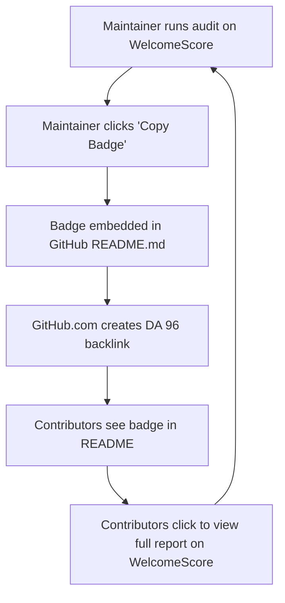

# ETHIOR WelcomeScore — Deep Off-Page SEO & Backlink Building Blueprint

> A high-impact, actionable playbook for acquiring Domain Authority (DA 80+) backlinks, scaling organic search discovery, and creating self-sustaining growth flywheels for WelcomeScore.

---

## 1. The Core Growth Engine: The GitHub README Badge Flywheel

The single highest-converting, highest-authority backlink strategy for developer tooling is the **README Badge Flywheel**. 

When an open-source maintainer adds the WelcomeScore badge to their repository's `README.md`, GitHub (`github.com`, **Domain Authority 96**) renders a permanent, high-trust dofollow backlink directly to WelcomeScore.



### Optimized Badge Snippet (SEO Anchor Text Enhanced)
```markdown
[](https://www.welcomescore.is-local.org/report/OWNER/REPO "WelcomeScore Contributor Readiness and DevOps Health Audit")
```

### HTML Variant for Modern HTML READMEs
```html
<a href="https://www.welcomescore.is-local.org/report/OWNER/REPO" title="WelcomeScore Contributor Readiness Audit">
  
</a>
```

### Action Plan: Seeding the Top 50 Beginner-Friendly Repositories
1. Identify 50 high-star open source projects with active `good first issue` labels (e.g. documentation sites, utility libraries, starter templates).
2. Run an audit on each repository using WelcomeScore.
3. Use the **1-Click Auto-Fix Engine** (`lib/autofix/engine.ts`) to generate a concrete improvement (e.g., adding PR checklist, issue forms, or CI dependency caching).
4. Submit a courteous Pull Request that resolves the issue and adds the WelcomeScore badge in their `README.md` alongside their existing build/license badges.

---

## 2. GitHub Marketplace Listing (`ethiorhq/welcomescore-action`)

GitHub Marketplace listings rank on Google for thousands of high-intent search queries (e.g., *"github actions contributor check"*, *"automated PR onboarding audit"*).

### Action Metadata (`action.yml`)
- **Name:** `WelcomeScore Contributor Audit`
- **Description:** `Deterministic 5-pillar open source contributor readiness & onboarding auditor for GitHub Actions.`
- **Categories:**
  - `Code Quality`
  - `Continuous Integration`
  - `Community`
- **Branding:** `icon: check-circle`, `color: orange`

### Backlinks Generated by the Action:
Every time the Action runs on a pull request or push, its automated summary comment posts:
```markdown
### 🛡️ WelcomeScore Contributor Audit: 85/100 (Grade B)

✅ CONTRIBUTING.md found and validated
✅ Code of Conduct present
✅ README local quickstart instructions verified
⚠️ Missing issue templates with acceptance criteria

[View Full Repository Audit Report →](https://www.welcomescore.is-local.org/report/${OWNER}/${REPO})
*Audited by [ETHIOR WelcomeScore](https://www.welcomescore.is-local.org)*
```
This generates organic backlinks on thousands of public pull request threads across GitHub.

---

## 3. npm Registry Authority (`@ethiorhq/welcomescore`)

The npm registry (`npmjs.com`, **Domain Authority 94**) passes substantial authority to linked homepages and repository URLs.

Ensure `packages/cli/package.json` contains:
```json
{
  "name": "@ethiorhq/welcomescore",
  "version": "0.1.0",
  "description": "Deterministic open-source contributor readiness & DevOps audit CLI by ETHIOR",
  "homepage": "https://www.welcomescore.is-local.org",
  "repository": {
    "type": "git",
    "url": "https://github.com/ethiorhq/welcomescore.git",
    "directory": "packages/cli"
  },
  "bugs": {
    "url": "https://www.welcomescore.is-local.org/faq#report-incorrect-signal"
  },
  "keywords": [
    "welcomescore",
    "ethior",
    "contributor-readiness",
    "github-audit",
    "devops-doctor",
    "open-source-onboarding",
    "good-first-issues"
  ]
}
```

---

## 4. Curated "Awesome Lists" PR Outreach

Awesome lists are heavily indexed by Google and cited by LLM search agents (ChatGPT, Perplexity, Claude). Submit targeted PRs adding WelcomeScore to:

| Target Awesome List | GitHub Repo | Recommended Category | Anchor Text & Description |
|---|---|---|---|
| **awesome-actions** | `sdras/awesome-actions` | `Code Quality / Community` | `[WelcomeScore](https://www.welcomescore.is-local.org)` — Automated contributor readiness and onboarding auditor. |
| **awesome-github** | `stefanbuck/awesome-github` | `Community Health & Analytics` | `[WelcomeScore](https://www.welcomescore.is-local.org)` — Deterministic 5-pillar contributor readiness grading for public repos. |
| **awesome-readme** | `matiassingers/awesome-readme` | `Badges & Quality Signals` | `[WelcomeScore Badges](https://www.welcomescore.is-local.org)` — Dynamic contributor-readiness and onboarding health badge. |
| **awesome-devops** | `wmariuss/awesome-devops` | `CI/CD Optimization` | `[DevOps Doctor](https://www.welcomescore.is-local.org/devops)` — GitHub Actions workflow profiler and wasted compute eliminator. |

---

## 5. Developer Community Launch Kits (Ready-to-Post)

### A. Hacker News — "Show HN" Copy
**Title:** `Show HN: WelcomeScore – Deterministic contributor readiness audit for GitHub repos`

**Submission Text:**
```markdown
Hey HN,

We built WelcomeScore (https://www.welcomescore.is-local.org) because open source onboarding is broken. Maintainers spend hours triaging repetitive beginner questions, while first-time contributors bounce due to vague READMEs, missing local setup steps, or abandoned "good first issues".

Instead of subjective linters, WelcomeScore runs an objective 5-pillar deterministic audit:
1. Documentation & Discovery (README setup path)
2. Contributor Onboarding (CONTRIBUTING.md rules)
3. Starter Issue Curation (active labels, scoped tasks)
4. Community & Security (CODE_OF_CONDUCT, LICENSE)
5. Activity & Velocity (triage ratios, recent push signals)

It also includes:
- DevOps Doctor: profiles GitHub Actions runner waste, concurrency locks, and copyleft risks
- Multi-Repo Fleet Cockpit: aggregates health across entire organizations
- Zero-token CLI: run `npx @ethiorhq/welcomescore` locally with zero source code uploads
- Active-active multi-server architecture on Cloudflare Workers and Vercel

We don't train AI on your code or inspect private repositories. 

Source code is available on GitHub: https://github.com/ethiorhq/welcomescore
Would love your feedback on the scoring methodology!
```

---

### B. Reddit Community Syndication Strategy

#### 1. `r/opensource`
- **Title:** *How we automated contributor onboarding audits to help first-timers find viable projects*
- **Focus:** The difficulty newcomers face when "good first issues" turn out to require production database credentials. Showcase the Next Useful Move framework.
- **Link:** `https://www.welcomescore.is-local.org/how-it-works`

#### 2. `r/webdev`
- **Title:** *Building an active-active dual server Next.js 14 architecture with Cloudflare Workers and Vercel*
- **Focus:** Technical deep dive into OpenNext, Cloudflare edge bindings, Turnstile bot defense, and real-time client-side mirror failover.
- **Link:** `https://www.welcomescore.is-local.org/policies/multi-server`

#### 3. `r/devops`
- **Title:** *I wrote a free tool that analyzes GitHub Actions workflows to find wasted runner compute*
- **Focus:** CI caching benchmarks (`actions/setup-node` vs standard download), concurrency `cancel-in-progress`, and license radar.
- **Link:** `https://www.welcomescore.is-local.org/devops`

---

### C. Dev.to & Hashnode Publication Outlines (With Canonical Links)

Publish companion long-form tutorials that rank for top-of-funnel keywords, with `canonical_url` set back to WelcomeScore:

1. **"The 2026 Open Source Contributor Onboarding Checklist"**
   - *Target Keyword:* `open source contributor checklist`
   - *Canonical:* `https://www.welcomescore.is-local.org/guides/open-source-contributor-onboarding-checklist`
2. **"How to Eliminate Wasted Billable Minutes in GitHub Actions Workflows"**
   - *Target Keyword:* `github actions cache optimizer`
   - *Canonical:* `https://www.welcomescore.is-local.org/devops`
3. **"Why Most Good First Issues Fail (And How to Fix Them)"**
   - *Target Keyword:* `good first issues open source guide`
   - *Canonical:* `https://www.welcomescore.is-local.org/guides/honest-good-first-issues`

---

## 6. GitHub Topic Optimization

Ensure the primary repository (`ethiorhq/welcomescore`) tags the following GitHub topics to appear in GitHub Explore and developer search:

- `contributor-readiness`
- `open-source-onboarding`
- `github-actions-audit`
- `devops-doctor`
- `good-first-issues`
- `readme-badge`
- `code-quality`
- `hacktoberfest`
- `maintainer-tools`
- `cloudflare-workers`

---

## 7. Metrics & Tracking Dashboard

| Backlink Channel | Metric to Track | Target |
|---|---|---|
| **README Badges** | Active GitHub repository embeds | 250+ repositories |
| **GitHub Marketplace** | Action installations / runs | 1,000+ weekly workflow runs |
| **npm Registry** | Weekly downloads of `@ethiorhq/welcomescore` | 500+ downloads/week |
| **Awesome Lists** | Merged PRs in curated lists | 5+ high-star awesome lists |
| **AI Citation Index** | Perplexity / ChatGPT citation presence | Cited for "contributor readiness audit" |
